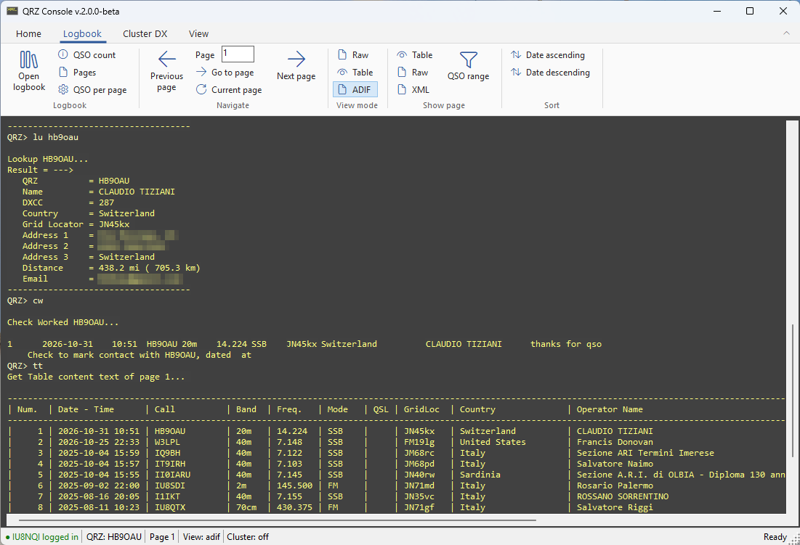

# QRZ Console

An unofficial command-line console for the QRZ.com website: lookup, logbook and Cluster DX with short commands,
plus an Office-like ribbon for the mouse.



## ⬇️ Download
| | |
|---|---|
| **[Download the installer (QRZConsole-Setup.exe)](https://github.com/StarNiell/QRZConsole/releases/latest/download/QRZConsole-Setup.exe)** | Recommended: run it and follow the steps. |
| [Download the portable version (QRZConsole-Portable.zip)](https://github.com/StarNiell/QRZConsole/releases/latest/download/QRZConsole-Portable.zip) | No installation: unzip anywhere and run `QRZConsole.exe`. |

Windows 10/11, 64 bit. Nothing else to install (the .NET runtime is included).
The files are not digitally signed, so Windows SmartScreen may warn the first time: choose *More info* > *Run anyway*.
All versions and release notes: [Releases page](https://github.com/StarNiell/QRZConsole/releases).

# About this repo

## General info
This project is a "unofficial command-line interface" to the QRZ.COM website and require a personal account.
For more information about the website, go to: https://www.qrz.com  

## Requirements
* Windows 10 (1809) or later, 64 bit. The .NET runtime is included in the download.
* Microsoft Edge WebView2 Runtime (already part of Windows 10/11; the installer checks it)


## Additional info
This release is a beta! It is therefore not considered "bug-free".
It's based on the automation of a web browser (web scraper), is still being optimized.

When you starting the software for the first time, it is advisable to view the list of available commands by typing "cm" ENTER
(You will find the list of available commands further down this page).

As you can see, commands consist of two characters and, as far as possible, are representations
memory of the functions they perform.

Some commands perform only one action, others need one or more parameters, still others return data.
The commands executed end up in the history (for each session) and to recover them, simply press
Up Arrow when the cursor is in the command box. It is possible to move the cursor back to the
command box by pressing the F2 key. With the DOWN arrow key it is possible to scroll the history forward.

ATTENTION! When using the Delete QSO ("dq") command: Before executing it, make sure that the position to be deleted
matches the selected one. The location of a QSO is determined by the ordering of the Logbook. Use
the "da" and "dd" commands to establish the order of the QSOs in the Logbook. (for security reasons, the "dq" command requires
entering 3 parameters, all the same, corresponding to the position to be deleted.

When adding a QSO to the Logbook using the "aq" command, the system automatically adds,
after the "aq" command SPACE ... the last QRZ in memory, the last frequency used and the last mode (SSB, AM, FM, etc...)
as well as the current date and time in UTC format. It is possible to move between the various parameters using the TAB key to scroll
right or SHIFT+TAB to scroll left.

Take a look at the list of all commands before starting.

Good Radio and excellent QSOs!


## Command List
```
-------------------------------------------------------------------------
  Description                           command [param] ...
-------------------------------------------------------------------------
Credentials:
  Is Logged                             il
  Is Logged (last status)               ls
  Login                                 li [username] [password]
  LogOut                                lo
Search:
  Lookup                                lu [qrz]
  Check Worked                          cw [qrz]
  Lookup and Check Worked               lw [qrz]
  Check Worked and Lookup               wl [qrz]
Logbook:
  Add QSO                               aq [qrz] [freq] [mode] [date] [time] [comment]
  Edit QSO                              eq [position] [qrz] [freq] [mode] [date] [time] [comment]
  Delete QSO                            dq [position] [position] [position] (enter 3 times the same position to delete for security reasons)
  Open Logbook                          lb
  QSO Count                             qc
  Logbook pages                         lp
  Get/Set QSO for page                  qp [entries] (valid values: 5, 10, 15, 20, 25, 50, 100, 200)
  Get/Set current view mode             cv [mode] (mode: [raw], [text] OR [adif])
  Goto Page                             gp [page]
  Page Down                             pd
  Page Up                               pu
  Current Page                          cp
  Order Date Asc                        da
  Order Date Desc                       dd
  Get Table Contente Text               tt [page]
  Get Table Contente Raw                tr [page]
  Get Table Content XML                 tx [page]
  Get QSOs by range Text View           qt [start position] [end position]
  Get QSOs by range Text Raw            qr [start position] [end position]
  Get QSOs by range ADIF                qa [start position] [end position]
Cluster DX:
  Open Cluster DX                       dx
  Show DX on Band                       sb [band] [items] (band example: [40m] [10m] or [hf] [vhf] [uhf])
  Show DX on Freq                       sf [freq] [items] (freq example: [7155] [14200] ...)
  Search Callsign on Cluster DX         ds [callsign]
  DXSpider command                      dc [DXSpider command: http://www.dxcluster.org/main/usermanual_en-12.html]
  Send Spot                             ss [call] [freq] [comment]
  Set default spots for sb/sf           di [items]
  Switch Cluster DX debug               cd
  Close Cluster DX                      cc
General/Utility:
  Clear Monitor                         cl
  Find DXCC Countries                   fc [search]
  Load Your Grid Locator                lc
  Get Grid Locator List                 gl [loc] [c or u] (example: gl [*] [c] - gl [EN70]
  Set current Frequency                 ff [freq]
  Set current QRZ                       qq [qrz]
  Load QRZ.com home page                hm
  Collapse / expand the ribbon          sw
  Switch Check Is Logged at startup     sc
  Switch screen (normal/fullsize)       fs
  Console theme                         th [theme name | list] (no parameter: theme editor)
  Last data in memory                   ld
  Switch browser (scraper) debug        bd
  Show form fields of the current page  bf
  Command List                          cm
  Shortcut List                         sl
  Quit                                  qi
-------------------------------------------------------------------------
```

## Development
Requires the .NET 10 SDK (Windows). Works with VS Code (C# extension) or the command line:
```
dotnet build QRZConsole.sln
dotnet test QRZConsole.Tests
```

Projects:
* **QRZConsole** - the console window (WinForms): output, keyboard, header buttons.
* **QRZConsole.Core** - commands (one class each, in `Commands/Builtin`), session, settings, DX cluster, formatting, page parsing. No UI, unit-tested.
* **QRZLibrary** - the QRZ.com scraper (WebView2). All page addresses, titles, ids and selectors are in `QrzSite.cs`.
* **QRZNetwork** - `WinsockClient`, a VB6 Winsock-like TCP client (async, events on the UI thread).
* **QRZConsole.Tests** - xUnit tests.

When QRZ.com changes its pages: run `bd` to see every browser step and timeout, `bf` to list the fields of the page
currently loaded, then adapt `QrzSite.cs` (selectors) or `QrzPageParser.cs` (how texts are read).

Releases are built and published by GitHub Actions (`.github/workflows/release.yml`) when a version tag is pushed:
```
git tag v2.0.1-beta
git push origin v2.0.1-beta
```
The tag decides the version; keep `Directory.Build.props` in line with it. Every release is marked as the latest
and its files are always named `QRZConsole-Setup.exe` and `QRZConsole-Portable.zip`, so the download links above never change.
The installer script is `installer/QRZConsole.iss` (Inno Setup).

To add a command: create a class deriving from `Command` in `QRZConsole.Core/Commands/Builtin` and register it in
`CommandCatalog.CreateDefault()`; the command list (`cm`) is built from it.

## Change Log
### 2026-10-31
* v.2.0.0-beta
* .NET 10, 64 bit, SDK-style projects (VS Code / dotnet CLI)
* Winsock Orcas replaced by QRZNetwork.WinsockClient
* Commands split into classes (QRZConsole.Core); DX cluster as a separate service
* Scraper rewritten: no more Internet Explorer control, page data read as JSON, safe JavaScript values, clear timeouts
* New commands: bd (browser debug), bf (form fields); hm, di, cd now listed
* Password saved encrypted (Windows DPAPI)
* Fix: aq/eq comment, frequencies with comma, hm/qp output
* Unit tests (QRZConsole.Tests)
* Command typed in line in the console (prompt "QRZ> "), colored output
* Office-like ribbon (Home, Logbook, Cluster DX, View) replacing the hidden buttons; status bar
* Configurable console theme (presets, colors, monospace font): View > Theme or "th"

### 2025-08-16
* v.1.0.1.1-beta
* Removed old MSBrowser (IE/EDGE)
* Added WebView2 (Chromium browser)

### 2024-04-21
* v.1.0.0.15-beta
* Fix Add QSO (wronmg receive frequency)
* Fix fail Edit QSO
  
### 2023-01-06
* *First public commit
* *v.1.0.0.13-beta

